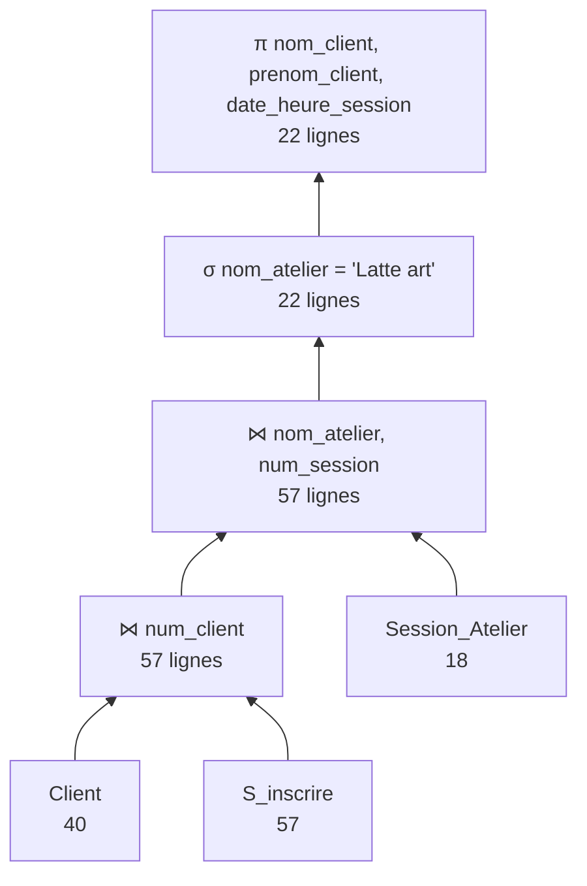
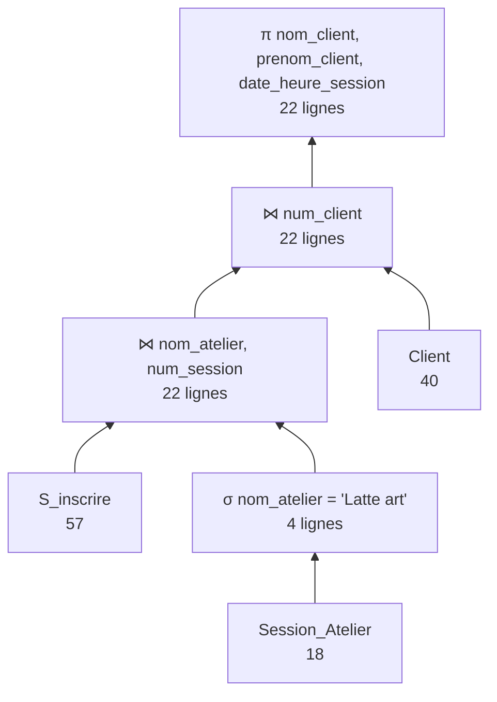

# ProjetDB_Meghelli_Mouawad
## Partie 1 : conception

Le PROMPT utilisé est le suivant :

> Tu travailles dans le domaine de la torréfaction et de la vente de café artisanal haut de gamme. Ton entreprise, Maison Aravelle, a comme activité de produire, torréfier et commercialiser un café artisanal haut de gamme issu de ses propres plantations (Algérie, Liban, Brésil, Pérou, Éthiopie, Colombie, Costa Rica), transformé et torréfié en France, ainsi que des cafetières (french press, cafetières italiennes), des verres, des services en porcelaine, des accessoires pour le café et des containers personnalisables, avec rachat de recharges à l’unité, en pack ou en abonnement, des coffrets saisonniers, des ateliers barista et des événements pour des sociétés et des événements internationaux. C’est une entreprise comme Nespresso, Momus Paris et L’Arbre à Café. Les données ont été collectées sur : les plantations et l’approvisionnement en café, la fabrication et la torréfaction (lots, machines), les fournisseurs, les produits et les coffrets, les ventes en boutiques (Paris, Monaco) et en ligne dans le monde, les recharges et abonnements, les ateliers barista, les événements, le sponsoring et les employés. Inspire-toi du site web suivant : https://www.nespresso.com/fr/fr ; https://momus-paris.com/?srsltid=AU7gw4UqzZI5PzUX_Hx9lynseFPVYFlb1S8uMj8v1mPHVa70W4tby0Sv ; https://www.larbreacafe.com/collections/cafes/products/nouvel-assemblage-canopee?variant=43105801437441.
>
> Ton entreprise veut appliquer MERISE pour concevoir un système d'information. Tu es chargé de la partie analyse, c’est-à-dire de collecter les besoins auprès de l’entreprise. Elle a fait appel à un étudiant en ingénierie informatique pour réaliser ce projet, tu dois lui fournir les informations nécessaires pour qu’il applique ensuite lui-même les étapes suivantes de conception et développement de la base de données.
>
> D’abord, établis les règles de gestions des données de ton entreprise, sous la forme d'une liste à puce. Elle doit correspondre aux informations que fournit quelqu’un qui connaît le fonctionnement de l’entreprise, mais pas comment se construit un système d’information.
>
> Ensuite, à partir de ces règles, fournis un dictionnaire de données brutes avec les colonnes suivantes, regroupées dans un tableau : signification de la donnée, type, taille en nombre de caractères ou de chiffres. Il doit y avoir entre 25 et 35 données. Il sert à fournir des informations supplémentaires sur chaque donnée (taille et type) mais sans a priori sur comment les données vont être modélisées ensuite.
>
> Fournis donc les règles de gestion et le dictionnaire de données.


Voici ce que L'IAG nous as rendus :

Au vus du format du READ ME j'ai ajouté la version PDF 


### Maison Aravelle
*Recueil des besoins : règles de gestion et dictionnaire de données*

#### 1. Règles de gestion

**Plantations et approvisionnement**

- Maison Aravelle possède ses propres plantations en Algérie, au Liban, au Brésil, au Pérou, en Éthiopie, en Colombie et au Costa Rica.
- Chaque plantation a un nom unique, se trouve dans un seul pays et est cultivée à une altitude donnée, en mètres. Un même pays peut compter plusieurs plantations.
- Une plantation cultive une ou plusieurs variétés de café (par exemple Bourbon, Geisha, Typica). Une même variété peut être cultivée dans plusieurs plantations.
- Le café vert récolté est envoyé en France, où il est torréfié.

**Fabrication et torréfaction**

- Le café est torréfié par lots. Chaque lot a un numéro unique (par exemple LT-2026-0457).
- Un lot est torréfié uniquement avec le café vert d'une seule plantation et d'une seule variété, pour garantir la traçabilité. Une plantation fournit de nombreux lots au fil des récoltes.
- Pour chaque lot, on note la date de torréfaction, le poids de café vert utilisé (en kg) et le profil de torréfaction (clair, moyen, foncé, espresso).
- Chaque lot passe sur une seule machine de torréfaction. Une machine, identifiée par son numéro de série, torréfie de nombreux lots.
- Chaque lot est conduit par un seul torréfacteur, qui est un employé. Un torréfacteur conduit plusieurs lots.
- Un lot sert à fabriquer un ou plusieurs produits café (paquets en grains, café moulu, recharges). Un même produit café peut être fabriqué à partir de plusieurs lots successifs. Les assemblages sont obtenus en mélangeant plusieurs lots.

**Fournisseurs**

- Maison Aravelle ne fabrique ni les cafetières (french press, italiennes), ni les verres, ni la porcelaine, ni les accessoires, ni les containers. Elle les achète à des fournisseurs.
- Chaque fournisseur est connu par sa raison sociale.
- Un fournisseur peut fournir plusieurs produits, et un même produit peut être acheté auprès de plusieurs fournisseurs.

**Produits et coffrets**

- Chaque produit a une référence unique, une désignation, une catégorie (café en grains, café moulu, recharge, cafetière, verre, porcelaine, accessoire, container, coffret) et un prix de vente unitaire TTC.
- Le prix d'un produit est le même en boutique et en ligne.
- Un coffret saisonnier (Noël, printemps…) est vendu comme un produit à part entière. Il se compose de plusieurs autres produits, par exemple deux cafés et une tasse. Un même produit peut entrer dans plusieurs coffrets.

**Ventes en boutique et en ligne**

- Les ventes se font dans les boutiques de Paris et de Monaco, ainsi que sur le site en ligne, avec une livraison partout dans le monde.
- Chaque commande a un numéro unique, une date et un canal de vente (boutique Paris, boutique Monaco ou en ligne).
- Une commande contient un ou plusieurs produits, chacun avec une quantité. Un même produit peut figurer dans de nombreuses commandes.
- Un client est connu par son nom, son prénom et son adresse e-mail, qui est unique. Un client peut passer plusieurs commandes.
- En ligne, toute commande est obligatoirement rattachée à un client et indique un pays de livraison.
- En boutique, le client n'est enregistré que s'il le souhaite. Une vente en boutique peut donc n'être rattachée à aucun client.
- Chaque vente en boutique est enregistrée par un seul vendeur, qui est un employé.

**Recharges, containers et abonnements**

- Le client achète un container réutilisable qu'il peut faire personnaliser par une gravure (nom ou message de 40 caractères au maximum).
- Les recharges s'achètent à l'unité, en pack ou par abonnement.
- Un abonnement est souscrit par un seul client. Un client peut avoir plusieurs abonnements.
- Chaque abonnement suit une formule (par exemple « Mensuel – 4 recharges ») et a une date de début. Il porte sur une ou plusieurs recharges.

**Ateliers barista**

- Les ateliers barista ont lieu en boutique, sous forme de sessions à une date et une heure précises.
- Chaque session a un nombre maximal de places (12 au plus) et est animée par un seul barista, qui est un employé.
- Un client peut s'inscrire à plusieurs sessions. Une session accueille plusieurs clients, dans la limite des places.

**Événements et sponsoring**

- Maison Aravelle organise des événements pour des entreprises (séminaires, soirées) et participe à des événements internationaux (salons, compétitions barista).
- Chaque événement a un nom, une date et une ville.
- Certains événements sont sponsorisés par Maison Aravelle, qui verse alors un montant de sponsoring. Les autres ne le sont pas.
- Un ou plusieurs employés travaillent sur chaque événement. Un employé peut travailler sur plusieurs événements.

**Employés**

- Chaque employé a un matricule unique, un nom et un poste (torréfacteur, barista, vendeur, responsable boutique, chargé d'événements…).

#### 2. Dictionnaire de données brutes

Types : AN = alphanumérique, N = numérique, D = date (JJ/MM/AAAA), DH = date et heure (JJ/MM/AAAA HH:MM).

| N° | Signification de la donnée | Type | Taille |
|---|---|---|---|
| 1 | Nom de la plantation | AN | 50 |
| 2 | Pays de la plantation | AN | 30 |
| 3 | Altitude de la plantation (m) | N | 4 |
| 4 | Variété de café cultivée | AN | 40 |
| 5 | Numéro du lot de torréfaction | AN | 12 |
| 6 | Date de torréfaction du lot | D | 10 |
| 7 | Poids de café vert utilisé pour le lot (kg) | N | 6 (dont 2 décimales) |
| 8 | Profil de torréfaction | AN | 15 |
| 9 | Numéro de série de la machine de torréfaction | AN | 20 |
| 10 | Raison sociale du fournisseur | AN | 60 |
| 11 | Référence du produit | AN | 10 |
| 12 | Désignation du produit | AN | 80 |
| 13 | Catégorie du produit | AN | 25 |
| 14 | Prix de vente unitaire TTC (€) | N | 7 (dont 2 décimales) |
| 15 | Numéro de commande | AN | 12 |
| 16 | Date de la commande | D | 10 |
| 17 | Canal de vente | AN | 20 |
| 18 | Quantité commandée d'un produit | N | 4 |
| 19 | Nom du client | AN | 50 |
| 20 | Prénom du client | AN | 50 |
| 21 | Adresse e-mail du client | AN | 100 |
| 22 | Pays de livraison | AN | 30 |
| 23 | Texte de personnalisation du container | AN | 40 |
| 24 | Formule d'abonnement | AN | 50 |
| 25 | Date de début de l'abonnement | D | 10 |
| 26 | Date et heure de la session d'atelier barista | DH | 16 |
| 27 | Nombre maximal de places de la session | N | 2 |
| 28 | Nom de l'événement | AN | 80 |
| 29 | Date de l'événement | D | 10 |
| 30 | Ville de l'événement | AN | 40 |
| 31 | Montant du sponsoring (€) | N | 9 (dont 2 décimales) |
| 32 | Matricule de l'employé | AN | 8 |
| 33 | Nom de l'employé | AN | 50 |
| 34 | Poste de l'employé | AN | 40 |

Le dictionnaire compte 34 données, toutes élémentaires. Les montants totaux de commande et les stocks n'y figurent pas, car on peut les calculer à partir des autres données.

---

## Partie 2 : MLD, MPD, insertion et interrogation

### Fichiers

- `1_creation.sql` : création de la base et des tables (MPD)
- `2_contraintes.sql` : contraintes de validation
- `prompt_insertion.txt` : prompt utilisé pour générer les données
- `3_insertion.sql` : script d'insertion obtenu
- `4_interrogation.sql` : requêtes d'interrogation

Ordre d'exécution : 1, 2, 3 puis 4.

### MLD

MLD généré avec Looping :


Version texte (clé primaire <ins>soulignée</ins>, clé étrangère précédée de #) :

**Entités**

- Pays (<ins>nom_pays</ins>)
- Variete (<ins>nom_variete</ins>)
- Fournisseur (<ins>raison_sociale</ins>)
- Machine (<ins>num_serie_machine</ins>)
- Employe (<ins>matricule_employe</ins>, nom_employe, poste)
- Produit (<ins>reference</ins>, designation, categorie, prix_unitaire_ttc)
- Client (<ins>num_client</ins>, nom_client, prenom_client, email_client)
- Atelier (<ins>nom_atelier</ins>, prix_atelier)
- Evenement (<ins>num_evenement</ins>, nom_evenement, date_evenement, ville_evenement, montant_sponsoring)
- Plantation (<ins>nom_plantation</ins>, altitude, #nom_pays)
- Lot (<ins>num_lot</ins>, date_torrefaction, poids_cafe_vert, profil_torrefaction, #nom_plantation, #nom_variete, #num_serie_machine, #matricule_employe)
- Commande (<ins>num_commande</ins>, date_commande, canal_vente, #num_client, #matricule_employe, #nom_pays)
- Abonnement (<ins>num_abonnement</ins>, formule, date_debut, #num_client)
- Session_Atelier (<ins>#nom_atelier, num_session</ins>, date_heure_session, nb_places_max, #matricule_employe)
- Container_Personnalise (<ins>#num_commande, num_container</ins>, texte_personnalisation, #reference)

**Associations devenues tables**

- Cultiver (<ins>#nom_plantation, #nom_variete</ins>)
- Servir_A (<ins>#num_lot, #reference</ins>)
- Fournir (<ins>#raison_sociale, #reference</ins>)
- Composer (<ins>#reference_coffrets, #reference_composants</ins>, quantite_composant)
- Contenir (<ins>#num_commande, #reference</ins>, quantite, prix_vente)
- Porter_Sur (<ins>#num_abonnement, #reference</ins>)
- S_inscrire (<ins>#num_client, #(nom_atelier, num_session)</ins>)
- Travailler_Sur (<ins>#matricule_employe, #num_evenement</ins>)

Les associations 1,n – 0,1 / 1,1 sont traduites par une clé étrangère dans la table côté 1 (ex : Plantation porte nom_pays). Les associations n,n deviennent des tables dont la clé primaire est composée des deux clés étrangères. Composer est une association réflexive sur Produit (un coffret est composé d'autres produits), d'où les deux clés étrangères reference_coffrets et reference_composants.

Session_Atelier et Container_Personnalise sont des entités faibles : une session n'existe que pour un atelier, et un container personnalisé que dans une commande. Leur clé primaire contient donc la clé de l'entité dont elles dépendent : (nom_atelier, num_session) et (num_commande, num_container). Du coup, S_inscrire référence une session par le couple (nom_atelier, num_session).

### MPD

Toutes les clés étrangères ont `ON UPDATE CASCADE`. Pour la suppression :

- `ON DELETE CASCADE` quand la ligne n'a pas de sens sans son parent (lignes de commande, inscriptions, lots d'une plantation...),
- `ON DELETE SET NULL` pour Commande : si un client, un employé ou un pays est supprimé, on garde quand même la commande pour l'historique des ventes. Ces trois colonnes sont donc nullables.

Contraintes de validation (`2_contraintes.sql`) : NOT NULL sur les champs obligatoires, UNIQUE sur l'email client, CHECK sur les valeurs positives (prix, quantités, poids, places, altitude, sponsoring), CHECK de liste pour le profil de torréfaction et le canal de vente, CHECK de format pour l'email, et une valeur par défaut 'Boutique' pour le canal de vente.

### Insertion des données

Les données ont été générées avec une IA à partir du prompt `prompt_insertion.txt`. On a repris la structure du prompt du TP1 (rôle, contexte, schéma, nombre de lignes, contraintes, format de sortie) et on a ajouté ce qui est propre à notre base :

- les cardinalités minimales à respecter (chaque commande contient au moins un produit, etc.),
- les règles métier : commande en boutique = un employé et pas de pays de livraison, commande web = un client et un pays de livraison, lots torréfiés uniquement par des torréfacteurs, container personnalisé présent dans sa commande,
- des cas particuliers pour tester les requêtes : 5 clients sans commande, des commandes boutique sans client, un produit jamais vendu (AC-BALANCE), une session sans inscrit (session 18).

Le script a ensuite été vérifié (clés étrangères, cardinalités, règles ci-dessus) avant d'être gardé.

### Scénario d'utilisation

L'utilisatrice est la responsable commerciale et marketing de Maison Aravelle. Elle prépare la campagne de fin d'année (coffrets, abonnements, containers personnalisés, ateliers) et suit en parallèle les achats de café vert.

Pour cela elle a besoin de :

- connaître le catalogue : catégories, produits dans une gamme de prix pour les idées cadeaux, composition des coffrets, prix moyen par catégorie ;
- connaître ses clients : clients Gmail pour un emailing, clients abonnés, clients qui n'ont jamais commandé ou jamais fait d'atelier (à relancer) ;
- analyser les ventes : nombre de commandes par année, chiffre d'affaires par canal, produits les plus vendus, produits jamais vendus, commandes web de la rentrée ;
- suivre les ateliers : sessions les plus remplies, liste des inscrits par atelier et par animateur ;
- mettre en avant l'origine des cafés : plantations d'altitude en Afrique de l'Est, traçabilité des lots de torréfaction claire.

Chaque requête de `4_interrogation.sql` correspond à un de ces besoins (le besoin est indiqué en commentaire).

### Étude d'un plan d'exécution

Requête étudiée : les clients inscrits à l'atelier « Latte art ».

```sql
SELECT cl.nom_client, cl.prenom_client, s.date_heure_session
FROM Client cl
JOIN S_inscrire si     ON si.num_client = cl.num_client
JOIN Session_Atelier s ON s.nom_atelier = si.nom_atelier
                      AND s.num_session = si.num_session
WHERE s.nom_atelier = 'Latte art';
```

Elle utilise trois opérateurs : sélection (σ), jointure (⋈) et projection (π).

Tailles des tables : Client = 40, S_inscrire = 57, Session_Atelier = 18. Il y a 4 sessions de Latte art et 22 inscriptions à ces sessions.

Règles de calcul (exercice 6 du TD3) :

- une jointure entre A de taille n1 et B de taille n2 fait n1 × n2 instructions,
- une sélection ou une projection parcourt toute la table de taille n, donc n instructions.

#### Plan 1 : jointures puis sélection

En algèbre relationnelle :

π<sub>nom_client, prenom_client, date_heure_session</sub> ( σ<sub>nom_atelier = 'Latte art'</sub> ( (Client ⋈<sub>num_client</sub> S_inscrire) ⋈<sub>nom_atelier, num_session</sub> Session_Atelier ) )



| Étape | Calcul | Instructions | Lignes obtenues |
|---|---|---|---|
| Client ⋈ S_inscrire | 40 × 57 | 2280 | 57 |
| ⋈ Session_Atelier | 57 × 18 | 1026 | 57 |
| σ nom_atelier = 'Latte art' | 57 | 57 | 22 |
| π | 22 | 22 | 22 |
| **Total** | | **3385** | |

#### Plan 2 : sélection en premier

En algèbre relationnelle :

π<sub>nom_client, prenom_client, date_heure_session</sub> ( Client ⋈<sub>num_client</sub> ( S_inscrire ⋈<sub>nom_atelier, num_session</sub> σ<sub>nom_atelier = 'Latte art'</sub> (Session_Atelier) ) )



| Étape | Calcul | Instructions | Lignes obtenues |
|---|---|---|---|
| σ nom_atelier = 'Latte art' | 18 | 18 | 4 |
| S_inscrire ⋈ σ(Session_Atelier) | 57 × 4 | 228 | 22 |
| ⋈ Client | 22 × 40 | 880 | 22 |
| π | 22 | 22 | 22 |
| **Total** | | **1148** | |

#### Conclusion

Le plan 2 demande environ 3 fois moins d'instructions (1148 contre 3385). En faisant la sélection dès le début, on passe de 18 sessions à 4, donc les jointures qui suivent portent sur beaucoup moins de lignes. L'ordre des jointures compte aussi : on joint d'abord S_inscrire avec les sessions filtrées (22 lignes) avant de joindre Client, au lieu de commencer par Client ⋈ S_inscrire qui coûte 2280 instructions à lui seul.

On pourrait aussi faire les projections plus tôt (garder seulement num_session et date_heure_session dans Session_Atelier, num_client, nom et prénom dans Client). Avec notre façon de compter, ça ajoute quelques instructions (18 + 4 + 228 + 40 + 880 + 22 = 1192) sans réduire le nombre de lignes, mais les lignes manipulées sont plus petites, ce qui prend moins de mémoire sur de grosses tables.

Le plan 2 est donc le plan optimisé : sélections le plus tôt possible, puis les jointures en commençant par celles qui donnent le moins de lignes.
